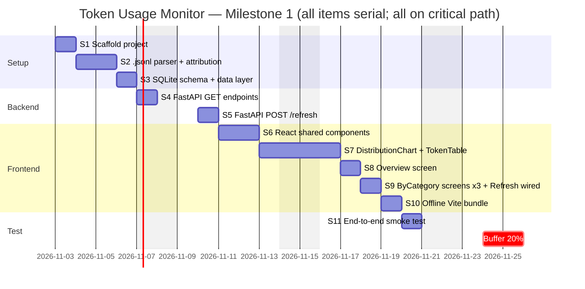
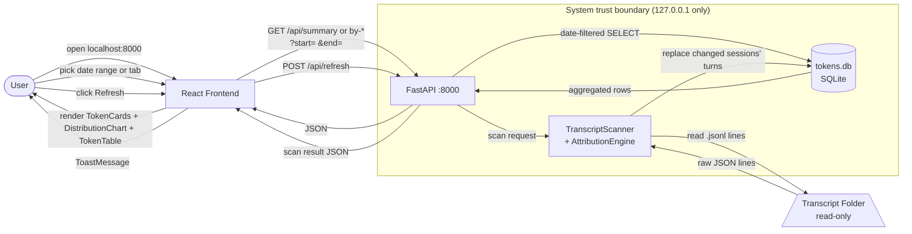
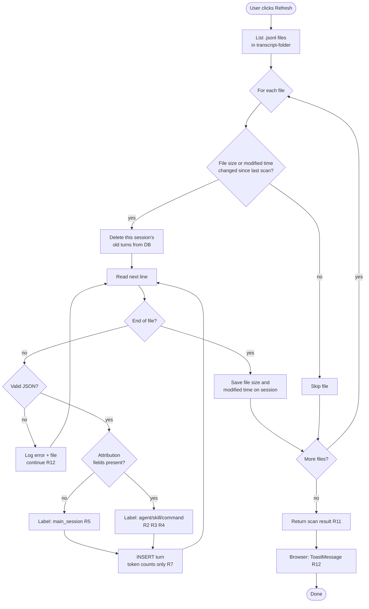
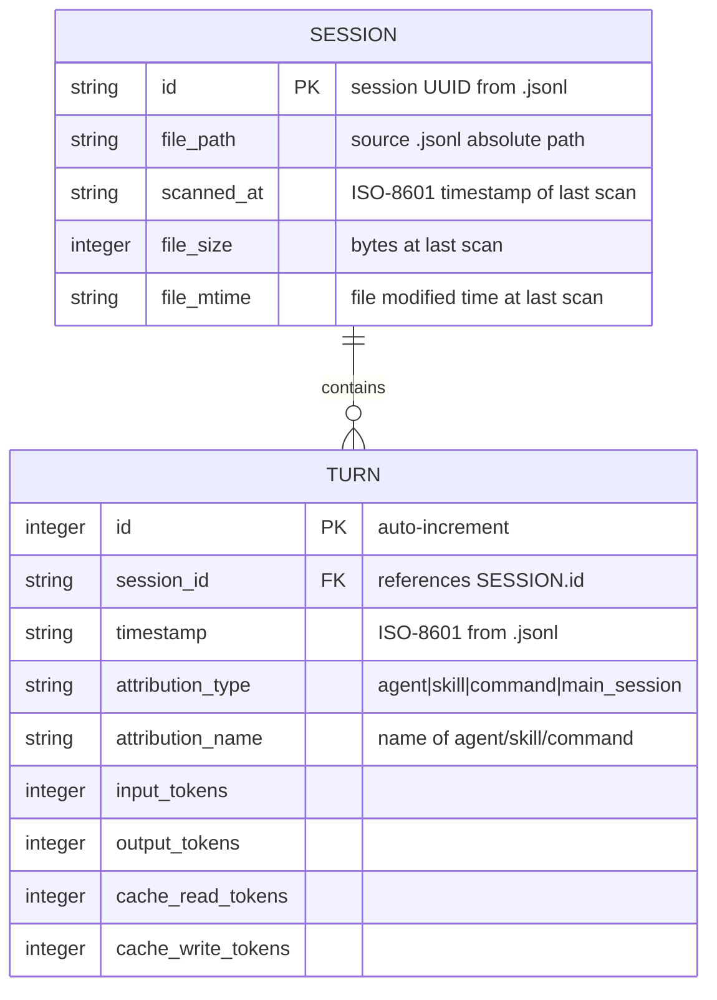
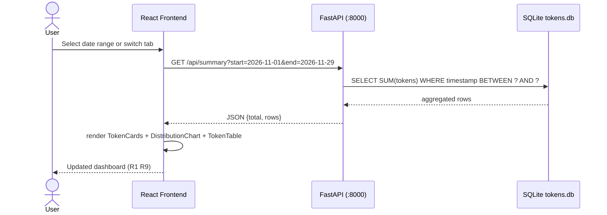

# Token Usage Monitor — Design

**Subproject:** `my-project/token-usage-monitor/`
**Owner:** Web App Lead (FastAPI + React)
**Date:** 2026-10-29
**Depth:** Full (13 requirements, 1 milestone)

---

## Requirements

| ID | Statement | Type | Priority | Acceptance Criterion |
|---|---|---|---|---|
| R1 | Show token usage (input, output, cache read, cache write) for D:\my-muti-agentic sessions | Functional | Must | Dashboard loads; all 4 token fields visible per category |
| R2 | Token usage split by agent | Functional | Must | Each agent name appears as its own row/chart segment |
| R3 | Token usage split by skill | Functional | Must | Each skill name appears as its own row/chart segment |
| R4 | Token usage split by command | Functional | Must | Each command name appears as its own row/chart segment |
| R5 | Unattributed turns shown as "main session" category | Functional | Should | Any turn not matching R2–R4 is counted under "main session" |
| R6 | Data source: .jsonl transcripts in `C:\Users\zoroa\.claude\projects\D--my-muti-agentic\` (read-only) | Constraint | Must | App reads only from that path; source files never modified |
| R7 | Store only token counts, names, session IDs, timestamps; no prompt/response text | Constraint | Must | Stored data inspection shows no prompt or response text |
| R8 | No LLM calls; no additional API cost | Constraint | Must | Network inspector shows zero calls to any LLM API |
| R9 | Dashboard includes a date-range filter | Functional | Must | User selects start/end date; only sessions in that range shown |
| R10 | Parsed token data stored in local SQLite database | Functional | Must | A tokens.db file exists after first scan |
| R11 | Manual "Refresh" button re-scans .jsonl files and updates SQLite | Functional | Must | Clicking Refresh triggers re-scan; new sessions, and new turns in changed session files, appear |
| R12 | App handles malformed or unreadable .jsonl files gracefully | Quality | Should | Malformed file shows warning banner; app continues; no crash |
| R13 | All frontend assets served locally; app works fully offline after install | Constraint | Must | App loads with no network; devtools show no external requests |

---

## Requirement Audit

**Verdict:** Pass with assumptions

**Resolved conflicts:** None found.

**Assumptions:**

| ID | Statement | Source |
|---|---|---|
| A1 | Single user — one person operates this tool | implied |
| A2 | Windows 11 only | user stated |
| A3 | Attribution is approximate | user stated |
| A4 | FastAPI + React is the preferred stack | user stated, confirmed Q5 |
| A5 | SQLite stored at `data/tokens.db` | default |
| A6 | Date filter: calendar date-range picker, daily granularity | default |
| A7 | Density: Compact | default |
| A8 | Typography: System sans | default |
| A9 | Navigation: Top tabs (Overview, By Agent, By Skill, By Command) | default |
| A10 | Responsiveness: Desktop only | default |
| A11 | Motion: Subtle — hover/fades ≤200 ms, honours reduced-motion | default |
| A12 | Accessibility: WCAG 2.2 AA | default |
| A13 | Language: English | default |
| A14 | Icons: Lucide (MIT) | default |
| A15 | Base components: data tables, summary cards, date-range filter, toast messages | default |

**Open questions (carried to build):**

| ID | Risk |
|---|---|
| OQ1 | Exact .jsonl field names unverified — attribution logic (R2–R5) may need revision; assumed field names listed in Text Design |
| OQ2 | Volume/performance unknown — Refresh may be slow on large histories; mitigate with batch read + progress indicator |
| OQ3 | Empty transcript folder — show empty-state message |

**Coverage gaps closed:** G1 (storage → R10), G2 (refresh → R11), G3 (done → R1+R9), G4 (capacity → schedule), G6 (errors → R12), G7 (offline → R13).

**Audit limit:** This report covers what the text, goal and checklist reveal; it cannot prove nothing is missing.

---

## System Type

**Type:** Web app — FastAPI backend + React frontend, served and viewed locally.
**Owner:** Web App Lead
**Deviations from standards:** Tailwind CSS chosen (Q10) instead of plain CSS default; named in this plan so the builder picks it up.

---

## UI Design

**Choices:**

| Question | Choice | Source |
|---|---|---|
| Visual style | Minimal clean | Q6, user |
| Colour theme | Dark + blue accent | Q7, user |
| Layout | Dashboard card grid (filter bar top, token cards, detail table) | Q8, user |
| Charts | Chart.js via react-chartjs-2 | Q9, user |
| Styling | Tailwind CSS (PostCSS build; offline per R13) | Q10, user |
| Demo | Yes — guided tour | Q11, user |
| Density | Compact | A7, default |
| Typography | System sans | A8, default |
| Navigation | Top tabs | A9, default |
| Responsiveness | Desktop only | A10, default |
| Motion | Subtle ≤200 ms | A11, default |
| Accessibility | WCAG 2.2 AA | A12, default |
| Language | English | A13, default |
| Icons | Lucide (MIT) | A14, default |

**Design tokens:**

| Token | Value |
|---|---|
| bg | `#0f172a` (slate-900) |
| surface | `#1e293b` (slate-800) |
| surface-raised | `#334155` (slate-700) |
| text | `#f8fafc` (slate-50) |
| muted | `#94a3b8` (slate-400) |
| accent | `#3b82f6` (blue-500) |
| accent-hover | `#2563eb` (blue-600) |
| success | `#22c55e` (green-500) |
| warning | `#f59e0b` (amber-500) |
| danger | `#ef4444` (red-500) |
| border | `#334155` (slate-700) |
| radius-card | `6px` |
| radius-btn | `8px` |
| font | `Inter, system-ui, sans-serif` |
| spacing | 4px base (Tailwind default) |

Contrast: `#f8fafc` on `#0f172a` = 17.5:1 (exceeds AA). `#94a3b8` on `#0f172a` = 5.4:1 (passes AA). Accent used only as non-text; labels always accompany colour signals.

**Screens:**

| Screen | Purpose | R-numbers |
|---|---|---|
| Overview | Aggregate totals across all categories; date filter | R1, R9, R11 |
| By Agent | Per-agent token breakdown; date filter | R2, R5, R9, R11 |
| By Skill | Per-skill token breakdown; date filter | R3, R5, R9, R11 |
| By Command | Per-command token breakdown; date filter | R4, R5, R9, R11 |

**Component inventory:**

| Component | States |
|---|---|
| FilterBar | default, disabled (during refresh) |
| TokenCard | default, loading, empty |
| DistributionChart | default, loading, empty |
| TokenTable | default, loading, empty, error |
| ToastMessage | success, warning, error (role="alert") |
| EmptyState | no-data, scan-error |
| LoadingSpinner | active |

**ASCII wireframe — Overview screen:**

```
┌─────────────────────────────────────────────────────────────┐
│ Token Usage Monitor                          [Refresh]       │
├──────────────┬───────────────┬──────────────┬───────────────┤
│  Overview    │   By Agent    │   By Skill   │  By Command   │
├─────────────────────────────────────────────────────────────┤
│  Date Range: [2026-11-01 ▾] → [2026-11-29 ▾]               │
├──────────────┬──────────────┬─────────────┬────────────────┤
│ Input Tokens │ Output Tokens│ Cache Read  │ Cache Write    │
│  1,234,567   │   456,789    │   890,123   │    12,345      │
├─────────────────────────────────────────────────────────────┤
│ Distribution (bar chart — react-chartjs-2)                  │
│ web-app-lead   ████████████████  450k                      │
│ main session   ████████████████████ 484k                   │
├──────────────┬──────────────┬───────────┬──────┬──────────┤
│ Name         │ Input        │ Output    │ C.R. │ C.W.     │
│ web-app-lead │ 450,000      │ 120,000   │ 300k │  5,000   │
│ design-lead  │ 300,000      │  80,000   │ 200k │  4,000   │
│ main session │ 484,567      │ 256,789   │ 390k │  3,345   │
└─────────────────────────────────────────────────────────────┘
```

By Agent / By Skill / By Command: same layout, data scoped to that category.

**Navigation map:** Overview ↔ By Agent ↔ By Skill ↔ By Command (top tabs). Any screen → [Refresh] → same screen + ToastMessage. Any screen → [change date range] → same screen filtered.

**Accessibility:** All interactive elements have visible focus rings. Charts include `aria-label`. ToastMessage uses `role="alert"`. Colour is never the only signal — labels accompany all chart bars.

---

## Text Design

### Components and responsibilities

| Component | Responsibility |
|---|---|
| TranscriptScanner | Lists .jsonl files in transcript-folder; skips files whose size and modified time are unchanged; re-reads changed files; calls AttributionEngine; writes to TokenStore |
| AttributionEngine | Classifies each turn: subagent → agent; slash-command → command; skill tool call → skill; else → main_session (approximate, A3) |
| TokenStore | SQLite wrapper: schema creation, replace a session's turns, date-filtered SELECT aggregates |
| FastAPI App | Entry point; mounts API routes; serves React `dist/` as static files |
| API Routes | Five modules: summary, by_agent, by_skill, by_command, refresh |
| React Frontend | SPA in `dist/`; four screens; shared components; calls local API only |

### Assumed .jsonl field names (OQ1 — verify against a real file before implementing S2)

Each line assumed to be a JSON object with:
- `sessionId` or `uuid` — session identifier
- `timestamp` — ISO-8601 string
- `message.usage.input_tokens`, `message.usage.output_tokens`, `message.usage.cache_read_input_tokens`, `message.usage.cache_creation_input_tokens`
- Attribution signal: subagent lines have `parentMessageId` or `type: "tool_result"` with agent name; command lines have `message.content` starting with `/`; skill lines have a tool call with skill name. **This schema is a hypothesis.**

### API contracts

`GET /api/summary?start=YYYY-MM-DD&end=YYYY-MM-DD`
```json
{
  "date_range": {"start": "string", "end": "string"},
  "total": {"input": 0, "output": 0, "cache_read": 0, "cache_write": 0},
  "rows": [{"category": "agent|skill|command|main_session", "name": "string",
            "input": 0, "output": 0, "cache_read": 0, "cache_write": 0}]
}
```

`GET /api/by-agent`, `GET /api/by-skill`, `GET /api/by-command` — same shape, rows filtered to the matching category.

`POST /api/refresh`
```json
{"status": "ok|partial", "sessions_scanned": 0, "errors": [{"file": "string", "error": "string"}]}
```

### Tech stack

| Layer | Technology |
|---|---|
| Backend | Python 3.11+ / FastAPI / Uvicorn |
| Database | SQLite via `sqlite3` stdlib |
| Frontend | React 18 + TypeScript / Tailwind CSS / Vite |
| Charts | react-chartjs-2 + Chart.js |
| Icons | lucide-react (MIT) |

### File layout

```
my-project/token-usage-monitor/
├── DESIGN.md
├── demo/
│   └── demo.html
├── backend/
│   ├── main.py              — FastAPI app; serves dist/
│   ├── scanner.py           — TranscriptScanner + AttributionEngine  R2–R6 R12
│   ├── db.py                — TokenStore  R7 R10
│   ├── routes/
│   │   ├── summary.py       — GET /api/summary  R1 R9
│   │   ├── by_category.py   — GET /api/by-{agent,skill,command}  R2–R4 R9
│   │   └── refresh.py       — POST /api/refresh  R11
│   └── requirements.txt
├── frontend/
│   ├── package.json
│   ├── tailwind.config.js
│   ├── postcss.config.js
│   ├── vite.config.ts       — builds to ../backend/dist/
│   └── src/
│       ├── App.tsx           — tab routing  A9
│       ├── components/
│       │   ├── FilterBar.tsx        R9
│       │   ├── TokenCard.tsx        R1
│       │   ├── DistributionChart.tsx  R1–R4
│       │   ├── TokenTable.tsx       R1–R4
│       │   ├── ToastMessage.tsx     R11 R12
│       │   └── EmptyState.tsx       OQ3
│       └── screens/
│           ├── Overview.tsx         R1 R9
│           └── ByCategory.tsx       R2–R5 R9
└── data/
    └── tokens.db             — created on first Refresh  A5
```

### Non-functional

**Secrets:** None (CLAUDE.md Rule 4). No API keys or credentials.

**Logging:** Uvicorn logs to stdout. `scanner.py` logs file errors to stdout and includes them in the POST /api/refresh response body (R12).

**Error handling:** Malformed .jsonl lines skipped with warning (R12). SQLite errors return HTTP 500 with a message, no stack trace.

**Security:** Server binds to `127.0.0.1` only. CORS restricted to `http://localhost:8000`. No filesystem access outside transcript-folder and `data/tokens.db` (R6).

**Out of scope:** Multi-project support, user accounts, real-time streaming, editing transcript files, any LLM call (R8).

---

## Roadmap



Done check for Milestone 1: Browser opens to dark dashboard at localhost:8000; shows token totals by agent/skill/command with date filter; Refresh re-scans transcripts; app loads with no network. Delivers R1–R13.

---

## Start → Goal List

**Start:** No tool exists; .jsonl transcripts accumulate in `C:\Users\zoroa\.claude\projects\D--my-muti-agentic\` with no way to view token counts by category.

**Goal:** Browser opens to a dark Minimal-clean dashboard at localhost:8000, shows token totals (input, output, cache read, cache write) by agent, skill, command and main session with a date-range filter; Refresh re-scans transcripts; all assets load offline.

| ID | Item | Serves | Owner | Depends on | Output | Done check | Est (d) | Start | End | Critical | Status |
|---|---|---|---|---|---|---|---|---|---|---|---|
| S1 | Scaffold: FastAPI + React/Tailwind/Vite + SQLite connection | R6 R10 R13 | Web App Lead | — | main.py, package.json, tokens.db | `uvicorn main:app` starts; browser shows React placeholder; tokens.db created | 1 | 2026-11-03 | 2026-11-03 | yes | [ ] |
| S2 | .jsonl parser + AttributionEngine (verify OQ1 field names first) | R2 R3 R4 R5 R6 R12 | Web App Lead | S1 | scanner.py | Parser reads a real .jsonl file; classifies turns; logs warnings for bad lines | 2 | 2026-11-04 | 2026-11-05 | yes | [ ] |
| S3 | SQLite schema + TokenStore (sessions, turns tables) | R7 R10 | Web App Lead | S1 | db.py | Schema created; INSERT and date-filtered SELECT work on test data | 1 | 2026-11-06 | 2026-11-06 | yes | [ ] |
| S4 | FastAPI GET /api/summary, /api/by-{agent,skill,command} | R1 R2 R3 R4 R9 | Web App Lead | S3 | routes/summary.py, routes/by_category.py | curl returns correct JSON shape; date params filter correctly | 1 | 2026-11-07 | 2026-11-07 | yes | [ ] |
| S5 | FastAPI POST /api/refresh | R11 | Web App Lead | S2 S3 S4 | routes/refresh.py | POST triggers scan; new sessions and new turns in changed files appear in GET responses; errors in JSON | 1 | 2026-11-10 | 2026-11-10 | yes | [ ] |
| S6 | React shared components: FilterBar, TokenCard, ToastMessage, EmptyState, LoadingSpinner | R1 R9 R11 R12 | Web App Lead | S1 | components/*.tsx | Each component renders with mock props; no console errors | 2 | 2026-11-11 | 2026-11-12 | yes | [ ] |
| S7 | DistributionChart (react-chartjs-2) + TokenTable | R1 R2 R3 R4 | Web App Lead | S6 | DistributionChart.tsx, TokenTable.tsx | Bar chart renders with mock data; table renders sortable rows | 2 | 2026-11-13 | 2026-11-14 | yes | [ ] |
| S8 | Overview screen: wires FilterBar + TokenCards + DistributionChart + TokenTable to GET /api/summary | R1 R9 | Web App Lead | S4 S6 S7 | Overview.tsx | Browser shows Overview with real DB data; date filter updates display | 1 | 2026-11-17 | 2026-11-17 | yes | [ ] |
| S9 | ByCategory screen ×3 (By Agent/Skill/Command); Refresh wired to POST /api/refresh + ToastMessage | R2 R3 R4 R5 R11 | Web App Lead | S5 S6 S7 S8 | ByCategory.tsx, App.tsx | All four tabs navigate; Refresh shows toast; EmptyState shown when no rows | 1 | 2026-11-18 | 2026-11-18 | yes | [ ] |
| S10 | Vite production build; FastAPI serves dist/; verify no CDN requests | R13 | Web App Lead | S9 | dist/ folder, updated main.py | App loads with Wi-Fi off; devtools show no external network requests | 1 | 2026-11-19 | 2026-11-19 | yes | [ ] |
| S11 | End-to-end smoke test with real .jsonl files; document resolved OQ1 | R1–R13 | Web App Lead | S10 | test notes | All 13 Rs pass; .jsonl field names documented | 1 | 2026-11-20 | 2026-11-20 | yes | [ ] |
| — | Buffer (20%) | — | — | S11 | — | — | 2 | 2026-11-24 | 2026-11-25 | — | [ ] |

All items serial (one work stream); every item is on the critical path.

---

## Schedule

**Mode:** A — estimate for me (no deadline).
**Capacity (hypothesis):** 7.5 h/week; ~1 work session per calendar weekday. Label: hypothesis, not a commitment.
**Start date assumption:** 2026-11-03 (Monday after design approval).
**Blocked dates:** none stated.
**Builder:** Web App Lead (Claude Code session) + user review.

**Three-point estimates:**

| ID | O (d) | M (d) | P (d) | Expected (d) | Confidence | Basis |
|---|---|---|---|---|---|---|
| S1 | 0.5 | 1.0 | 2.0 | 1.1 | Medium | Standard scaffold; Vite+Tailwind config adds time |
| S2 | 0.5 | 1.5 | 3.0 | 1.6 | Low | OQ1: field names unverified; heuristic may need rework |
| S3 | 0.5 | 1.0 | 2.0 | 1.1 | Medium | Two-table schema; well-understood |
| S4 | 0.5 | 1.0 | 2.0 | 1.1 | Medium | Four similar endpoints; date filter is main concern |
| S5 | 0.25 | 0.5 | 1.0 | 0.5 | High | Thin endpoint; calls scanner |
| S6 | 0.5 | 1.5 | 2.5 | 1.5 | Medium | Multiple stateless components |
| S7 | 0.5 | 1.5 | 3.0 | 1.6 | Medium | Chart.js integration + table sorting |
| S8 | 0.25 | 0.5 | 1.0 | 0.5 | High | Wiring only; components done |
| S9 | 0.25 | 0.5 | 1.0 | 0.5 | High | ByCategory is reusable; three instances |
| S10 | 0.25 | 0.5 | 1.5 | 0.6 | Medium | Vite build standard; offline check adds time |
| S11 | 0.25 | 1.0 | 2.0 | 1.0 | Medium | Depends on OQ1 surprises |
| **Total** | | | | **11.1** | | |
| **Buffer (20%)** | | | | **2.2** | | |
| **With buffer** | | | | **13.3** | | |

**Expected finish:** 2026-11-20. **With buffer:** 2026-11-25.
**Pessimistic finish (all P summed = 21.0 d):** 2026-12-17. Label: upper bound, not forecast.
Gantt bars round up to whole days; exact values are in the table above.

**Top 3 risks:**
1. **S2 (OQ1 — field names)** — if attribution fields differ from assumptions, S2 expands to 3 d+; inspect a real .jsonl file before writing any parser code.
2. **S7 (Chart.js)** — react-chartjs-2 v5/v6 API differences; pin to a known version in package.json.
3. **S10 (offline bundle)** — Tailwind or dynamic import may pull in a CDN URL; verify with devtools network tab with Wi-Fi off.

---

## Structure

```
my-project/token-usage-monitor/          root
├── DESIGN.md
├── demo/
│   └── demo.html                        guided-tour demo  [Design Lead]
├── backend/                             Backend layer
│   ├── main.py                          FastAPI entry; serves API + dist/  R6 R8 R13  [Backend Coder]
│   ├── scanner.py                       TranscriptScanner + AttributionEngine  R2–R6 R12  [Backend Coder]
│   ├── db.py                            TokenStore (SQLite)  R7 R10  [Backend Coder]
│   ├── routes/
│   │   ├── summary.py                   GET /api/summary  R1 R9  [Backend Coder]
│   │   ├── by_category.py               GET /api/by-{agent,skill,command}  R2–R4 R9  [Backend Coder]
│   │   └── refresh.py                   POST /api/refresh  R11  [Backend Coder]
│   └── requirements.txt
├── frontend/                            Frontend layer
│   ├── vite.config.ts                   builds to backend/dist/  R13  [Frontend Coder]
│   ├── tailwind.config.js
│   ├── postcss.config.js
│   └── src/
│       ├── App.tsx                      tab routing  A9  [Frontend Coder]
│       ├── components/
│       │   ├── FilterBar.tsx            R9  [Frontend Coder]
│       │   ├── TokenCard.tsx            R1  [Frontend Coder]
│       │   ├── DistributionChart.tsx    R1–R4  [Frontend Coder]
│       │   ├── TokenTable.tsx           R1–R4  [Frontend Coder]
│       │   ├── ToastMessage.tsx         R11 R12  [Frontend Coder]
│       │   └── EmptyState.tsx           OQ3  [Frontend Coder]
│       └── screens/
│           ├── Overview.tsx             R1 R9  [Frontend Coder]
│           └── ByCategory.tsx           R2–R5 R9  [Frontend Coder]
├── data/
│   └── tokens.db                        SQLite; created on first Refresh  R10 A5
└── External
    ├── react-chartjs-2 + Chart.js       MIT
    ├── lucide-react                     MIT
    └── Tailwind CSS                     MIT
```

---

## Working Flow



Caption: Token data flows read-only .jsonl → TranscriptScanner → SQLite → FastAPI → React. No data leaves the trust boundary. No external network calls (R8).

---

## Logic Flow

Main use case: Refresh scan.



Caption: A changed or new file is re-read in full and its turns replaced, so a growing session is never double-counted and never missed (R11). Every malformed line is skipped; app never crashes on a bad file (R12). Attribution falls back to main_session when fields are absent (R5).

---

## Data Model



Caption: Two tables only. No prompt or response text stored (R7). Date-range queries filter on `TURN.timestamp`. Attribution columns serve R2–R5. `file_size` and `file_mtime` let Refresh detect a changed file.

---

## Type Add-on (Web App)

### Sequence diagram — GET /api/summary



### Deployment sketch

```
┌──────────────────────────────────────────────────────────┐
│ Windows 11 — 127.0.0.1 only (R8 R13)                     │
│                                                           │
│  ┌─────────────────────────┐   ┌───────────────────────┐ │
│  │ Browser                 │   │ uvicorn               │ │
│  │ http://localhost:8000   │◄─►│ FastAPI :8000         │ │
│  │ (React SPA from dist/)  │   │ CORS: localhost only  │ │
│  └─────────────────────────┘   └──────────┬────────────┘ │
│                                           │              │
│                               ┌───────────▼────────────┐ │
│                               │ data/tokens.db (SQLite)│ │
│                               └────────────────────────┘ │
│                                                           │
│  C:\Users\zoroa\.claude\projects\D--my-muti-agentic\     │
│  *.jsonl  ← read-only; never written by this app (R6)    │
└──────────────────────────────────────────────────────────┘
No external network calls. Frontend assets in backend/dist/ (R13).
```

---

## Demo

**Path:** `my-project/token-usage-monitor/demo/demo.html`
**How to open:** Double-click in Explorer or `start demo\demo.html` from a terminal. No server required.

**R-numbers covered:** R1, R2, R3, R4, R5, R9, R11, R12.

**Not shown in demo (static file):**

| R | Reason |
|---|---|
| R6 | Live .jsonl file read requires filesystem access |
| R7 | SQLite data inspection requires a real database |
| R8 | Network inspector check is done in browser devtools on the real app |
| R10 | No tokens.db in demo |
| R13 | Demo itself is offline; real app bundle is a separate Vite build |

---

## Requirement Traceability

| R | Diagram element |
|---|---|
| R1 | TokenCard (Structure), GET /api/summary (Working flow, Sequence), TURN table (Data model), Overview screen |
| R2 | By Agent screen, GET /api/by-agent (Working flow), DistributionChart + TokenTable, attribution_type=agent (Data model) |
| R3 | By Skill screen, GET /api/by-skill, attribution_type=skill (Data model) |
| R4 | By Command screen, GET /api/by-command, attribution_type=command (Data model) |
| R5 | AttributionEngine fallback → main_session (Logic flow), attribution_type=main_session (Data model) |
| R6 | Transcript Folder node (Working flow), TranscriptScanner reads TF, deployment sketch |
| R7 | TURN table fields (Data model — no text columns) |
| R8 | "No external network calls" note (Working flow, deployment sketch) |
| R9 | FilterBar (Structure, Working flow), ?start=&end= params (Working flow, Sequence) |
| R10 | tokens.db (Structure, Data model, deployment sketch) |
| R11 | POST /api/refresh (Working flow, Logic flow), FilterBar Refresh button (Structure), SESSION.file_size/file_mtime (Data model) |
| R12 | "Log error + continue" (Logic flow), ToastMessage (Structure, Working flow) |
| R13 | dist/ served by FastAPI (Structure, deployment sketch), S10 offline bundle (Start→Goal) |
