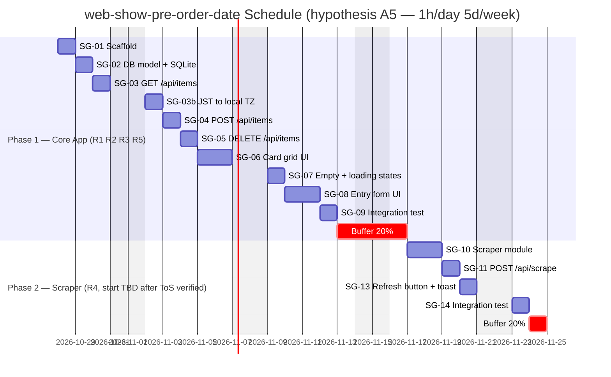
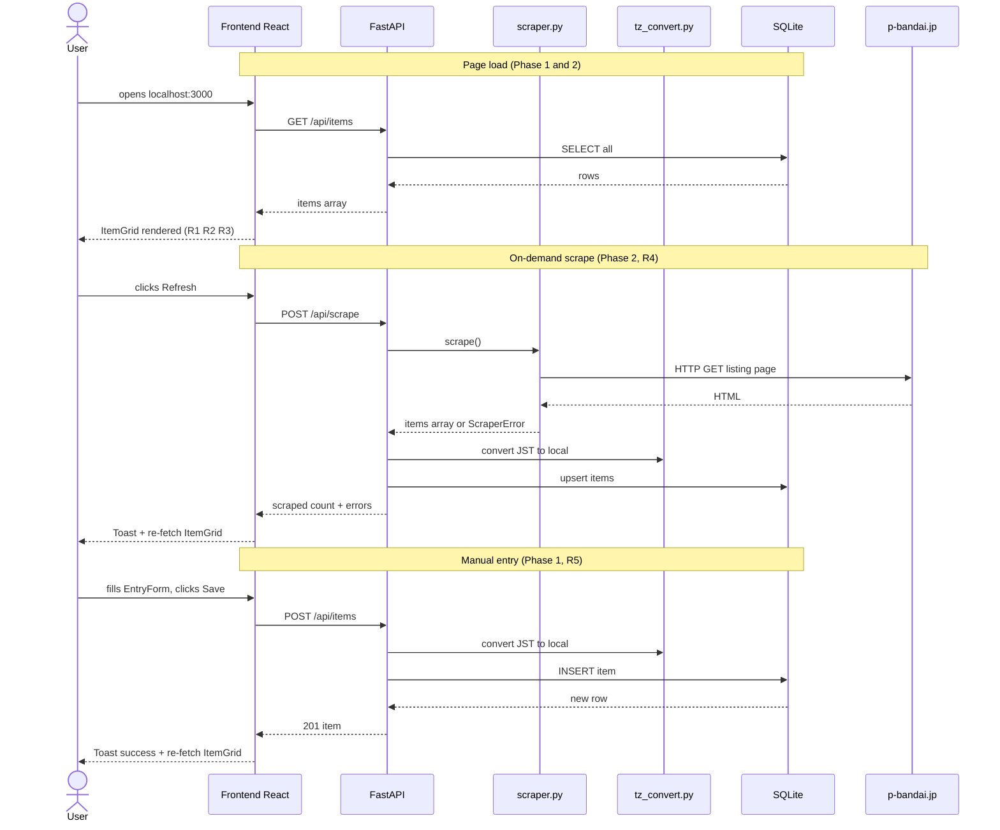
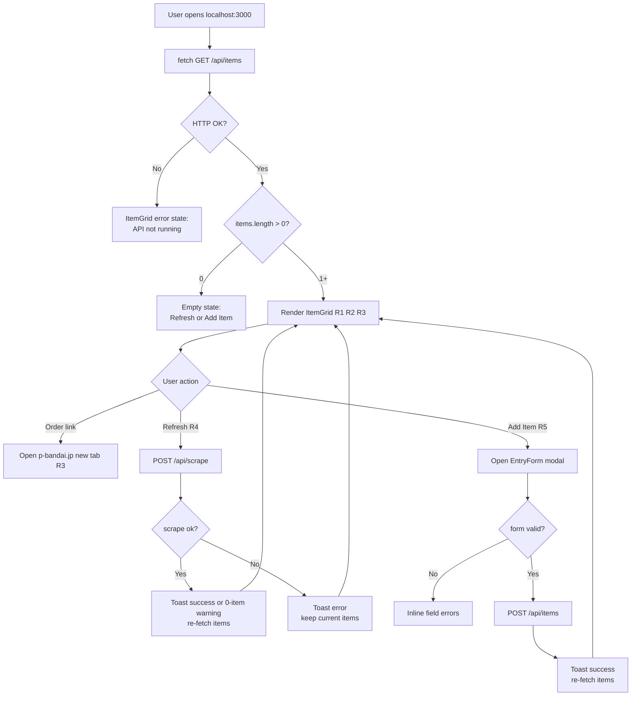
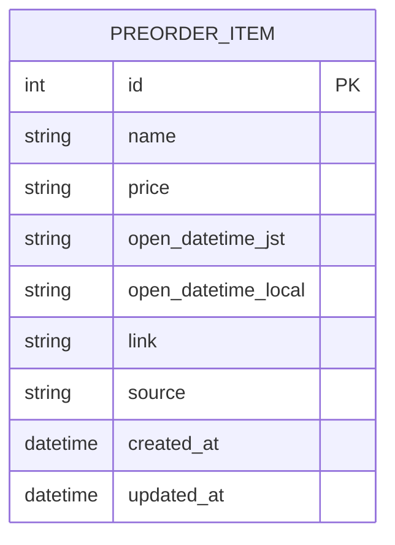
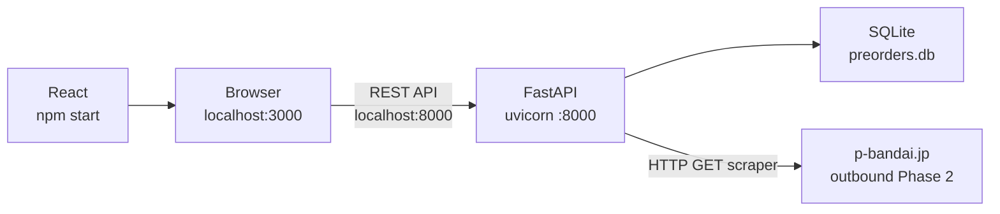

# DESIGN — web-show-pre-order-date

**Subproject:** `my-project/web-show-pre-order-date/`
**Design date:** 2026-10-28
**Depth:** Light (5 requirements, 2 milestones)
**Owner:** Web App Lead (React + FastAPI)

---

## 1. Requirements

| ID | Statement | Type | Priority | Acceptance criterion | Status |
|---|---|---|---|---|---|
| R1 | The web app displays a list of Bandai Gundam pre-order items | Functional | Must | Opening localhost:3000 shows at least one item card or an empty-state message | Fixed |
| R2 | Each item shows price, pre-order open date, and open time converted from JST to the user's PC local timezone | Functional | Must | Each card displays a price string, a local-timezone date, and a local-timezone time | Fixed |
| R3 | Each item has a clickable link that opens the p-bandai.jp pre-order page in a new browser tab | Functional | Must | Link element opens the correct URL in a new tab | OK |
| R4 | An on-demand Refresh button triggers the scraper to fetch new items from p-bandai.jp; result shown in a toast | Functional | Must | Clicking Refresh calls POST /api/scrape; DB updates; grid re-renders; toast shows count or error | Phase 2 (after ToS verified) |
| R5 | A manual-entry form lets the user add items without scraping (fallback if scraping is prohibited by ToS) | Functional | Should | User submits form; item appears in grid; invalid fields show inline errors | Phase 1 (primary build path) |

---

## 2. Requirement Audit

**Verdict:** Pass with assumptions

**Resolved conflicts:**
- Constraint-clash-1 (local PC + scheduled scraping): resolved by Q8=A (on-demand only); no scheduled task needed.

**Open questions / risks:**
- OQ-1: p-bandai.jp ToS and robots.txt not yet verified. User chose to verify ToS first (Q5=B); Phase 2 waits for that check. Phase 1 is fully usable on its own.
- OQ-2: p-bandai.jp may be JavaScript-rendered. httpx+BeautifulSoup4 alone may return empty HTML. Builder must test the site render method and choose httpx+BS4 or Playwright before building scraper.py.

**Coverage gaps (non-blocking):**
- Edit/update item: not a Must; user can delete and re-add. PUT /api/items/{id} is out of scope.
- Product thumbnail/image: out of scope; placeholder icon used.

**Assumptions:**

| ID | Statement |
|---|---|
| A1 | "Pre-order openings" = when a new item becomes available for pre-order on p-bandai.jp |
| A2 | Data stored in SQLite (single file); expected volume under 1,000 rows |
| A3 | Demo: Yes, guided-tour form (recommended default; not asked, to stay within the pass cap) |
| A4 | No auth needed; site is private localhost only (Q3=A, Q4=B) |
| A5 | Schedule Mode A; capacity = 1h/day, 5 days/week (not confirmed by user — hypothesis; adjust before building) |
| A6 | No product images in Phase 1; placeholder icon used |
| A7 | All UI choices are recommended defaults, not asked (see §4); user may change them before build starts |

*This audit shows what the text, the goal and the checklist reveal; it cannot prove nothing is missing.*

---

## 3. System Type

**Type:** Web App (local, localhost only)
**Owner:** Web App Lead
**Stack:** React 18 (port 3000) + FastAPI Python 3.11+ (port 8000) + SQLite
**Deployment:** User runs both processes on their PC; all traffic stays on 127.0.0.1
**Deviations from owner standards:** none

---

## 4. UI Design

### Choices table (A7 — all recommended defaults)

| Question | Choice | Source |
|---|---|---|
| Visual style | Soft modern (rounded corners, subtle shadows) | recommended |
| Colour theme | Dark + blue accent | recommended |
| Layout | Dashboard card grid | recommended |
| Density | Comfortable | default |
| Typography | System sans-serif | default |
| Navigation | Single page | recommended |
| Responsiveness | Responsive (desktop + phone) | recommended |
| Motion | Subtle (hover + fades ≤200 ms); honours prefers-reduced-motion | default |
| Components | Cards, Toast messages, Forms | recommended |
| Accessibility | WCAG 2.2 AA | default |
| Language | English | default |
| Icons | Lucide (openly licensed) | default |
| Styling | Plain CSS with design tokens | Web App Lead standard |

### Design tokens

| Token | Value |
|---|---|
| --bg | #0f1117 |
| --surface | #1a1d2e |
| --text | #e2e8f0 |
| --muted | #64748b |
| --accent | #3b82f6 |
| --success | #22c55e |
| --warning | #f59e0b |
| --danger | #ef4444 |
| --font | system-ui, sans-serif |
| --size-base | 16px |
| --space | 4px / 8px base |
| --radius | 8px |
| --shadow | 0 2px 8px rgba(0,0,0,0.4) |

Contrast check: --text (#e2e8f0) on --bg (#0f1117) ≈ 13:1 (passes AAA). --accent (#3b82f6) on --surface (#1a1d2e) ≈ 4.8:1 (passes AA). --muted used only for labels paired with visible names; colour is never the only signal.

### Screen list

| Screen | Purpose | R-numbers |
|---|---|---|
| Main — ItemGrid | Card grid of pre-order items; Refresh and Add Item buttons; last-scraped timestamp | R1, R2, R3, R4 |
| Modal — EntryForm | Form to add an item manually | R5 |

### Wireframes

**Main — ItemGrid (with items)**
```
┌──────────────────────────────────────────────────────────┐
│  Bandai Gundam Pre-Orders         [↻ Refresh] [+ Add Item]│
│  Last scraped: 2026-10-28 04:00 JST / 23:00 local        │
│──────────────────────────────────────────────────────────│
│ ┌──────────────────┐ ┌──────────────────┐ ┌─────────────  │
│ │ [icon]           │ │ [icon]           │ │ [icon]        │
│ │ MG Zeta 2.0      │ │ PG Nu Gundam     │ │ RG Sinanju    │
│ │ ¥8,800           │ │ ¥38,500          │ │ ¥5,280        │
│ │ Nov 1, 2026      │ │ Nov 5, 2026      │ │ Nov 10, 2026  │
│ │ 11:00 PM local   │ │ 11:00 PM local   │ │ 2:00 AM local │
│ │ [Order →]        │ │ [Order →]        │ │ [Order →]     │
│ └──────────────────┘ └──────────────────┘ └─────────────  │
└──────────────────────────────────────────────────────────┘
```

**Main — ItemGrid (empty state)**
```
┌────────────────────────────────────────┐
│  Bandai Gundam Pre-Orders              │
│                                        │
│          [lock icon]                   │
│    No pre-orders yet.                  │
│    Click Refresh to scrape, or         │
│    click + Add Item to enter one.      │
└────────────────────────────────────────┘
```

**Modal — EntryForm**
```
┌──────────────────────────────────────┐
│  Add Pre-Order Item              [X] │
│                                      │
│  Product name  [                  ]  │
│  Price         [                  ]  │
│  Open date     [YYYY-MM-DD        ]  │
│  Open time(JST)[HH:MM             ]  │
│  Link (URL)    [https://...       ]  │
│                                      │
│                  [Cancel]   [Save]   │
└──────────────────────────────────────┘
```

### Component inventory

| Component | States |
|---|---|
| ItemCard | default, hover (shadow lift), loading-skeleton, empty-placeholder |
| Refresh button | default, loading (spinner), disabled-while-scraping |
| Add Item button | default, hover |
| EntryForm | default, field-invalid (red border + message), submitting (Save disabled), success (closes + toast) |
| Toast | success (green + checkmark), error (red + x), auto-dismiss 4 s; role="alert" aria-live="polite" |

### Navigation map
```
Main ──[+ Add Item]──► EntryForm Modal ──[Save / Cancel]──► Main
Main ──[Refresh]─────► (in-place update, stays on Main)
Main ──[Order →]─────► p-bandai.jp (new tab, leaves app)
```

### Accessibility notes
- All interactive elements have visible focus rings and aria-labels.
- Form fields: visible `<label>` + `aria-describedby` for error messages.
- Toast: `role="alert"` + `aria-live="polite"`.
- Order link: `aria-label` includes "opens in new tab".
- Colour is never the only signal (icons + colour on all status states).
- `prefers-reduced-motion`: disable all CSS transitions.

---

## 5. Text Design

### Components and responsibilities

| Component | File | Single responsibility |
|---|---|---|
| App | frontend/src/App.jsx | Root state (items, loading, error, modal-open), all API calls |
| ItemGrid | frontend/src/ItemGrid.jsx | Renders card grid, empty state, loading skeleton (R1) |
| ItemCard | frontend/src/ItemCard.jsx | Renders one item: name, price, local date/time, order link (R2, R3) |
| EntryForm | frontend/src/EntryForm.jsx | Controlled form, client-side validation, POST /api/items (R5) |
| Toast | frontend/src/Toast.jsx | Status messages, auto-dismiss timer |
| Styles | frontend/src/index.css | CSS custom properties (tokens), layout, card, form, modal styles |
| FastAPI app | backend/main.py | CORS config (localhost:3000 only), route mount, DB init on startup |
| Routes | backend/routes.py | REST handlers: GET/POST/DELETE /api/items; POST /api/scrape |
| Models | backend/models.py | SQLAlchemy PreOrderItem model; Pydantic ItemIn + ItemOut schemas |
| Database | backend/database.py | SQLite engine (preorders.db), session factory, create_all() on startup |
| Scraper (Ph2) | backend/scraper.py | Fetch p-bandai.jp listing page, parse HTML, return list of dicts |
| TZ convert | backend/tz_convert.py | Convert JST datetime string to PC local timezone string via zoneinfo (Phase 1; used by manual entry and the scraper) |

### API contracts

**GET /api/items**
Response 200: `[{"id": int, "name": str, "price": str, "open_date_local": str, "open_time_local": str, "link": str, "source": "scraper"|"manual"}]`

**POST /api/items**
Request body: `{"name": str, "price": str, "open_datetime_jst": "YYYY-MM-DDTHH:MM", "link": str}`
Response 201: `{"id": int, "name": str, "price": str, "open_date_local": str, "open_time_local": str, "link": str, "source": "manual"}`

**DELETE /api/items/{id}**
Response 204 No Content / 404 Not Found

**POST /api/scrape** (Phase 2)
Response 200: `{"scraped": int, "errors": [str]}`

### Tech stack

| Layer | Technology | Notes |
|---|---|---|
| Frontend | React 18, plain CSS | Web App Lead standard |
| Backend | FastAPI, Python 3.11+ | Web App Lead standard |
| Database | SQLite via SQLAlchemy | Single local file; no server process |
| Scraper (Ph2) | httpx + BeautifulSoup4, or Playwright | Builder confirms after testing p-bandai.jp render method (OQ-2) |
| Timezone | Python zoneinfo (stdlib) | No extra install; JST → PC local |
| CORS | FastAPI CORSMiddleware | allow_origins=["http://localhost:3000"] only |

### File layout

```
my-project/web-show-pre-order-date/
  DESIGN.md
  demo/
    demo.html
  backend/
    main.py
    models.py
    routes.py
    database.py
    scraper.py          (Phase 2; empty stub in Phase 1)
    tz_convert.py
    requirements.txt
    start.bat           (Windows: uvicorn main:app --reload --port 8000)
  frontend/
    public/
      index.html
    src/
      App.jsx
      ItemGrid.jsx
      ItemCard.jsx
      EntryForm.jsx
      Toast.jsx
      index.css
    package.json
  run.bat               (starts backend + frontend in two cmd windows)
```

### Non-functional

- **Security:** CORS restricts to localhost:3000; no auth needed (Q3=A, Q4=B); no public-facing port.
- **Secrets:** none; scraper is anonymous HTTP GET; no API keys (CLAUDE.md Rule 4).
- **Logging:** FastAPI default stderr logging; scraper errors returned in POST /api/scrape response body, not swallowed.
- **Error handling:** scraper HTTP/parse error → error list in response body; frontend shows Toast error. A scrape that returns 0 items shows a warning toast, never a silent success. API unreachable → ItemGrid error state with message. Invalid form fields → inline per-field messages.
- **Backup:** not required; personal use; data recoverable by re-scraping or re-entering.
- **Performance:** SQLite under 1,000 rows; no pagination needed.

### Out of scope
Authentication; product thumbnails; scheduled scraping; price history or charts; multiple source sites; email or desktop notifications; public deployment; edit/update item (user deletes and re-adds).

---

## 6. Roadmap



*Gantt bars round up to 1d minimum; exact estimates in §8. Phase 2 shown immediately after Phase 1 for illustration; actual Phase 2 start is TBD. SG-12 was moved into Phase 1 as SG-03b because manual entry (R5) also needs JST → local conversion.*

---

## 7. Start → Goal List

**Start:** Empty `my-project/web-show-pre-order-date/` folder with DESIGN.md only.
**Goal:** Running local app at localhost:3000 showing Bandai Gundam pre-order items with price, local open date/time, and order link; data added manually via form (Phase 1) or fetched on-demand from p-bandai.jp (Phase 2, after ToS verified).

| ID | Item | Serves | Owner | Depends on | Output | Done check | Est (d) | Start | End | Critical | Status |
|---|---|---|---|---|---|---|---|---|---|---|---|
| SG-01 | Scaffold project, install deps | — | Web App Lead | — | folder layout, package.json, requirements.txt | npm install and pip install both exit 0 | 0.5 | Oct 28 | Oct 28 | yes | [ ] |
| SG-02 | Database model + SQLite setup | — | Web App Backend Coder | SG-01 | models.py, database.py; preorders.db on first run | DB file created; table has all columns | 0.5 | Oct 29 | Oct 29 | yes | [ ] |
| SG-03 | GET /api/items endpoint | R1, R2 | Web App Backend Coder | SG-02 | routes.py (read) | curl GET returns [] or items list with all fields | 0.5 | Oct 30 | Oct 30 | yes | [ ] |
| SG-03b | JST to local timezone conversion | R2 | Web App Backend Coder | SG-02 | tz_convert.py | "2026-11-01T16:00+09:00" converts correctly to user's local time string | 0.5 | Nov 2 | Nov 2 | yes | [ ] |
| SG-04 | POST /api/items endpoint | R5 | Web App Backend Coder | SG-02, SG-03b | routes.py (create) | POST with valid body returns 201; item appears in next GET with local date/time | 0.5 | Nov 3 | Nov 3 | yes | [ ] |
| SG-05 | DELETE /api/items/{id} endpoint | — | Web App Backend Coder | SG-03 | routes.py (delete) | DELETE returns 204; item absent from next GET | 0.5 | Nov 4 | Nov 4 | yes | [ ] |
| SG-06 | Frontend card grid | R1, R2, R3 | Web App Frontend Coder | SG-03 | ItemGrid.jsx, ItemCard.jsx, index.css | Cards display name, price, local date/time, order link | 1.0 | Nov 5 | Nov 6 | yes | [ ] |
| SG-07 | Frontend empty, loading, error states | R1 | Web App Frontend Coder | SG-06 | App.jsx, ItemGrid.jsx | Empty state visible with no items; spinner on load; error message on API failure | 0.5 | Nov 9 | Nov 9 | yes | [ ] |
| SG-08 | Frontend manual entry form | R5 | Web App Frontend Coder | SG-04, SG-06 | EntryForm.jsx, Toast.jsx | Form submits; item appears in grid; invalid fields show inline errors | 1.0 | Nov 10 | Nov 11 | yes | [ ] |
| SG-09 | Phase 1 integration test | R1–R3, R5 | User | SG-01–SG-08 | test notes | All R1–R3 and R5 acceptance criteria pass manually | 0.5 | Nov 12 | Nov 12 | yes | [ ] |
| SG-10 | (Ph2) Scraper module for p-bandai.jp | R4 | Web App Backend Coder | SG-02, ToS verified | scraper.py | scrape() returns items list; ScraperError raised on failure | 2.0 | TBD | TBD | yes | [ ] |
| SG-11 | (Ph2) POST /api/scrape endpoint | R4 | Web App Backend Coder | SG-10, SG-03b | routes.py (scrape) | POST triggers scraper; items upserted with local date/time; response has count + errors list | 0.5 | TBD | TBD | yes | [ ] |
| SG-12 | (withdrawn — moved to Phase 1 as SG-03b) | — | — | — | — | — | — | — | — | — | — |
| SG-13 | (Ph2) Refresh button + toast | R4 | Web App Frontend Coder | SG-11 | App.jsx (Refresh), Toast.jsx | Click Refresh triggers POST /api/scrape; toast shows count, 0-item warning, or error | 0.5 | TBD | TBD | yes | [ ] |
| SG-14 | (Ph2) Phase 2 integration test | R4 | User | SG-10–SG-13 | test notes | Refresh fetches real items from p-bandai.jp; grid updates with correct local times | 0.5 | TBD | TBD | yes | [ ] |

*All items serial — one work stream assumed (A5). Phase 2 depends on ToS verification outside the schedule.*

---

## 8. Schedule

**Mode:** A (estimate for me)
**Capacity:** 1h/day, 5 days/week — hypothesis A5; not confirmed by user; adjust before building
**Start:** 2026-10-28
**Blocked dates:** none stated

| ID | Est (d) | Conf | Basis | Start | End |
|---|---|---|---|---|---|
| SG-01 | 0.5 | High | Standard React+FastAPI scaffold | Oct 28 | Oct 28 |
| SG-02 | 0.5 | High | Single SQLAlchemy table | Oct 29 | Oct 29 |
| SG-03 | 0.5 | High | Standard CRUD read | Oct 30 | Oct 30 |
| SG-03b | 0.5 | Medium | Python zoneinfo, test edge cases | Nov 2 | Nov 2 |
| SG-04 | 0.5 | High | Standard CRUD create | Nov 3 | Nov 3 |
| SG-05 | 0.5 | High | Standard CRUD delete | Nov 4 | Nov 4 |
| SG-06 | 1.0 | Medium | React fetch + CSS grid + card component | Nov 5 | Nov 6 |
| SG-07 | 0.5 | Medium | Conditional render states | Nov 9 | Nov 9 |
| SG-08 | 1.0 | Medium | Form validation + POST + toast | Nov 10 | Nov 11 |
| SG-09 | 0.5 | High | Manual walkthrough | Nov 12 | Nov 12 |
| Buffer (20%) | 1.5 | — | 20% of Phase 1 effort (6.5d) = 1.3d, rounded up | Nov 13 | Nov 16 |
| **Phase 1 total** | **8.0d** | — | — | Oct 28 | **Nov 16** |
| SG-10 | 2.0 | Low | p-bandai.jp HTML unknown; JS-render risk OQ-2 | TBD | TBD |
| SG-11 | 0.5 | High | Standard POST trigger | TBD | TBD |
| SG-13 | 0.5 | High | Button + toast wire-up | TBD | TBD |
| SG-14 | 0.5 | Medium | Depends on real site response | TBD | TBD |
| Buffer (20%) | 1.0 | — | 20% of Phase 2 effort (3.5d) = 0.7d, rounded up | TBD | TBD |
| **Phase 2 total** | **4.5d** | — | — | TBD | **TBD+5** |

**Phase 1 expected finish (with buffer):** 2026-11-16 (hypothesis)
**Phase 2 expected finish:** TBD start + 5 working days

**Top 3 risks:**
1. SG-10 (Low conf): p-bandai.jp is JavaScript-rendered — Playwright needed instead of httpx+BS4 — add 1–2d
2. OQ-1: ToS prohibits scraping — Phase 2 cancelled; Phase 1 (manual entry) becomes the complete product
3. SG-08 (Medium conf): form validation complexity higher than expected — add 0.5d if needed

*All estimates are hypotheses, not commitments.*

---

## 9. Structure Diagram

```
web-show-pre-order-date
├── Frontend (React :3000)
│   └── App.jsx — state + API calls
│       ├── ItemGrid.jsx — R1
│       │   └── ItemCard.jsx — R2 R3
│       ├── EntryForm.jsx — R5
│       └── Toast.jsx
├── Backend (FastAPI :8000)
│   └── main.py — CORS, startup
│       └── routes.py — REST handlers
│           ├── tz_convert.py — R2, Phase 1
│           ├── scraper.py — R4, Phase 2
│           └── database.py
│               └── models.py
├── Data
│   └── preorders.db
└── External
    └── p-bandai.jp — Phase 2 only
```

*Tree = what contains what; each item has one parent. Calls between files are in the Working Flow Diagram (§10). All traffic stays on 127.0.0.1 except the scraper outbound (Phase 2).*

---

## 10. Working Flow Diagram



---

## 11. Logic Flow Diagram



---

## 12. Data Model



*One entity; no foreign keys at this scope. `open_datetime_jst` stores the original source string for re-conversion if needed; `open_datetime_local` stores the converted local-timezone string served to the frontend.*

---

## 13. Type Add-on — Deployment Sketch



**Ports:** Frontend 3000, Backend 8000. Both on 127.0.0.1 only.
**CORS:** `allow_origins=["http://localhost:3000"]`.
**Startup:** `run.bat` opens two cmd windows — one runs `uvicorn main:app --reload`, one runs `npm start`. Builder provides `run.bat`.

---

## 14. Demo

**Path:** `my-project/web-show-pre-order-date/demo/demo.html`
**How to open:** Double-click in file explorer; opens in any browser offline; no server required.
**Form:** Guided tour — 3 slides with Next / Back buttons.

| R | In demo | Notes |
|---|---|---|
| R1 | Yes — slide 1: card grid with 3 mock items | |
| R2 | Yes — slide 1: price, local date, local time on each mock card | |
| R3 | Yes — slide 1: Order buttons visible (disabled; no real URL loaded) | |
| R4 | No | Requires running FastAPI backend; shown as disabled Refresh button with explanatory note |
| R5 | Yes — slide 3: EntryForm modal with pre-filled mock data; Save shows toast demo | |

---

## 15. Requirement Traceability

| R | Diagram element |
|---|---|
| R1 | ItemGrid (Structure §9, Working flow §10, Logic flow §11 "Render ItemGrid") |
| R2 | ItemCard (Structure §9), `open_datetime_local` field (ER §12), TZ node (Working flow §10), GET /api/items contract (§5), SG-03b (Start to Goal §7) |
| R3 | ItemCard "Order link" (Structure §9), "Open p-bandai.jp new tab" (Logic flow §11) |
| R4 | Scraper (Structure §9), POST /api/scrape (Working flow §10, Logic flow §11), SG-10, SG-11, SG-13, SG-14 (Start to Goal §7) |
| R5 | EntryForm (Structure §9), POST /api/items (Working flow §10, Logic flow §11), SG-04, SG-08 (Start to Goal §7) |
